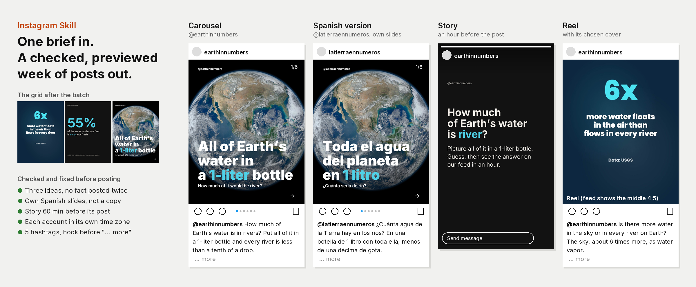

# Instagram Skill for Claude Code, Codex, Cursor and OpenClaw

**Instagram Skill** is a free, open-source Instagram skill for Claude Code and other AI agents that makes, checks, previews and schedules Instagram posts: carousels, single images, Reels and Stories, for one account or many. You give your agent an idea, a link, notes, your photos or a video. It decides the format, writes the words, makes the media on your own computer, fixes every file Instagram would reject, shows you the posts exactly as they'll appear in the feed and the grid, and schedules them after you say yes:

- carousels and single images rendered as 1080x1350 JPEGs, with a cover that survives the 3:4 profile grid;
- your own photos and screenshots converted and fitted (PNG, HEIC, 3:4, panoramas);
- your own videos finished as Reels: 9:16, H.264 and AAC, your landscape clips framed under a headline instead of cropped blind, a chosen cover, and a check of what Instagram's caption and buttons cover;
- Story frames that tease a post an hour before it goes out;
- every file and caption checked against Instagram's current limits, with fixes written as new files;
- a preview page of the grid, the feed view with the "... more" cut, and every slide;
- one schedule for several accounts, each with its own version of the post, its own caption and its own time zone;
- results read back and ranked against your own posts of the same format and age.

Everything up to posting runs locally with Python, Pillow and ffmpeg. No paid API. MIT licensed.

```bash
npx skills add social-media-skills/instagram-skill -g -a claude-code -y
```



*The example in [`examples/water-week/`](skills/instagram-skill/examples/water-week/): a week for a made-up science account in English and Spanish, with figures from the USGS Water Science School and a NASA photo. The slides, checks, preview, schedule and requests were made by the skill's scripts; the Reel is the account's own short, made with the Remotion Shorts Skill. See [CREDITS](skills/instagram-skill/examples/water-week/CREDITS.md).*

## Contents

- [What the Instagram skill does](#what-the-instagram-skill-does)
- [Requirements](#requirements)
- [Install](#install)
- [Example: a week of Instagram posts with Claude Code](#example-a-week-of-instagram-posts-with-claude-code)
- [What it checks](#what-it-checks)
- [Posting and scheduling](#posting-and-scheduling)
- [What it won't do](#what-it-wont-do)
- [FAQ](#faq)
- [What's inside](#whats-inside)

## What the Instagram skill does

Tell your agent "post this to Instagram", "turn this blog post into a week of Instagram posts", "post this video as a Reel" or "schedule these to my three accounts" and it does the whole job:

1. **Knows the account.** It asks once what the account is about, who it's for, the handles, brand colour and each account's time zone, saves the answers to `brand.md`, and looks at your current grid and recent posts so it doesn't repeat them.
2. **Picks the format for each post** and says why: carousels for saves, Reels for reach to non-followers, a single image for one strong point, a Story for existing followers. Every post in a batch carries its own idea.
3. **Makes the media.** Carousels, single images and Story frames are rendered locally in three tested styles. Your photos go in as they are or inside slides. Your videos become Reels with a cover picked from the sharpest frames; your own landscape clips become framed Reels instead of being cropped blind.
4. **Writes the captions:** the search phrase and the hook before the "... more" cut, one ask, at most 5 hashtags, alt text for every image. A second account gets its own version of the post, not just its own caption.
5. **Checks and fixes** every file and caption with `ig_check.py`, writing fixes as new files and keeping your originals.
6. **Schedules** the batch at the times your Insights show, in each account's own time zone, with Stories placed around the post they belong to and a first-hour plan for each post.
7. **Shows a preview** of the grid and the feed and waits for one clear yes.
8. **Posts through WoopSocial**, then logs every post and, a few days later, ranks them by sends, saves and follows per reach against your own posts of the same format.

## Requirements

- Python 3.9 or newer with Pillow (`pip install pillow`); on Windows also `pip install tzdata`.
- ffmpeg for anything with video (Reels, video Stories, video carousel items). Photos and carousels work without it.
- Optional: `pillow-heif` for iPhone .heic photos.
- An agent that can run commands on your computer (Claude Code, Codex, Cursor, OpenClaw or similar).

`python3 scripts/check_setup.py` tells you what's missing and the install command for your system. A CI workflow runs the full pipeline on macOS, Windows and Ubuntu.

## Install

**Claude Code**

```bash
npx skills add social-media-skills/instagram-skill -g -a claude-code -y
```

**Codex, Cursor and other agents:** run `npx skills add social-media-skills/instagram-skill` and pick your agent, or copy `skills/instagram-skill/` into your agent's skills directory.

**OpenClaw (ClawHub):** `openclaw skills install @social-media-skills/instagram-skill`

**GitHub CLI:** `gh skill install social-media-skills/instagram-skill instagram-skill`

**Gemini CLI:** `gemini extensions install https://github.com/social-media-skills/instagram-skill`

## Example: a week of Instagram posts with Claude Code

```
You:   A week of posts for @earthinnumbers (New York, followers online
       around 12:30) and the Spanish account @latierraennumeros (Madrid,
       13:30) about Earth's water. Real numbers. Our animated short about
       the air is attached.

Agent: Three ideas, one per post, from the USGS table:
       Mon: a carousel, "All of Earth's water in a 1-liter bottle": pour
       out the oceans and 35 ml is left; every river is less than a
       tenth of a drop. Spanish slides for the Spanish account, not just
       a translated caption. A Story an hour before asks the question.
       Tue: a single image, 55% of the water under our feet is salty.
       Wed: your short as a Reel (English only), cover picked from its
       sharpest frames; nothing sits under Instagram's caption or buttons.

       Checks: everything passes. Preview: preview/index.html.

You:   Looks good. Schedule it.

Agent: Validated 7 posts. Scheduled in each account's own time zone; the
       first-hour plan and the in-app checklist (alt text, sharing the
       post to your Story with the post sticker) are in schedule.md.
```

The plan, the slides, the Reel cover sheets, the preview page, the schedule and the WoopSocial requests from this run are in [`examples/water-week/`](skills/instagram-skill/examples/water-week/).

## What it checks

| Check | Rule | Why |
|---|---|---|
| Image type | JPEG, sRGB, 320 to 1440 px wide, 8 MB at most | The Instagram API rejects PNG, WebP and HEIC |
| Image shape | 4:5 to 1.91:1 for feed posts; 9:16 for Stories | Taller images like 3:4 are rejected through the API |
| Carousel | 2 to 20 items, all the shape of the first | Instagram crops every item to the first one |
| Video | MP4 or MOV, H.264, 8-bit, AAC, 23 to 60 fps, 9:16 for Reels | 10-bit and HDR video comes out grey or fails |
| Length | Reels 3 s to 15 min, Stories up to 60 s, carousel videos up to 60 s | API limits |
| Grid | Warns when the 3:4 grid hides more than 12% of a cover | The grid crops every post to 3:4 |
| Reel zones | `reel.py zones` shades what the caption, buttons and top bar cover | Text under the interface can't be read |
| Caption | 2,200 characters, 5 hashtags, 20 mentions, hook before the "... more" cut, no clickable-link illusions | Instagram's limits, and what the feed shows |
| Accounts | A real version per account, different first lines, posts per day | Instagram's 2026 originality rules cover photos and carousels; the same media on a second account is likely seen as a repost |
| Batch | Warns when two posts lead with the same number | One fact posted three times reads as filler |

Each fact, with its source and date, is in [`references/instagram-specs.md`](skills/instagram-skill/references/instagram-specs.md).

## Posting and scheduling

Posting goes through [WoopSocial](https://woopsocial.com/?utm_source=instagram-skill&utm_medium=readme), a social media API and MCP server for AI agents (see its [Instagram MCP](https://woopsocial.com/social-media-mcp/instagram-mcp?utm_source=instagram-skill&utm_medium=readme)). Disclosure: this skill is maintained by Frank Heijdenrijk and the team behind WoopSocial. The free plan covers 2 social accounts. Setup steps for every agent are at [woopsocial.com/agents](https://woopsocial.com/agents?utm_source=instagram-skill&utm_medium=readme).

The agent uploads each file, writes one request per post and account, validates them, and shows you the preview and the schedule before anything is sent. It posts only after a clear yes. Through WoopSocial it can post feed images, carousels, Reels (with a cover, and as Trial Reels when your account qualifies) and Stories, now or scheduled. Collaborators, location, music, alt text and first comments aren't available through it; the skill lists them per post so you add them in the app. WoopSocial also provides analytics for your posts and accounts; the skill reads the post numbers back after a few days to rank what worked. WoopSocial doesn't write captions or edit media; the skill does that on your computer and you approve it. If you'd rather not connect anything, you get the files, captions and schedule to post yourself.

Instagram posting needs a Business or Creator account. Switching is free in the app.

## What it won't do

- Invent numbers, results, reviews or quotes. Every figure needs a source.
- Post anything without your yes on the preview.
- Give you a generic "best time to post". It uses your own Insights, then your own results.
- Post the same media and caption to several accounts.
- Edit your footage (cuts, captions, music). It finishes a video you've made for Instagram.
- Make text-only animated Reels; it tells you when an idea fits a carousel better.
- Crop or pad your landscape video without asking, or dress up someone else's clip as yours.

## FAQ

**What is an Instagram skill?** An agent skill (a folder with a `SKILL.md`) that teaches an AI agent such as Claude Code how to do a job on Instagram. This one includes the scripts that make and check the posts, so the agent produces real files, not just advice.

**Can Claude post to Instagram?** Yes. With this skill and WoopSocial's MCP connected, Claude Code, Claude Desktop, Codex, Cursor and OpenClaw can post and schedule to Instagram after you approve each batch.

**Is this an Instagram MCP?** The skill uses [WoopSocial's Instagram MCP](https://woopsocial.com/social-media-mcp/instagram-mcp?utm_source=instagram-skill&utm_medium=readme) to post. The skill adds what an MCP alone doesn't: making the media, checking it, the preview, per-account captions and the learning loop.

**Can I schedule Instagram posts to several accounts?** Yes. One plan, one request per account, each account with its own version of the post, its own caption and its own time zone.

**Does it work with a personal Instagram account?** No app can post to a personal account through Instagram's API. Switch to a free Creator or Business account in the app.

**Why 4:5 and not 3:4?** The profile grid shows 3:4, but Instagram's API only accepts 4:5 to 1.91:1. The skill renders 4:5 and keeps the cover text inside what the grid shows.

**How many hashtags?** Five at most, since December 2025. The checker stops at six.

**Does it work without WoopSocial?** Yes. Everything up to the schedule is local. Posting, and the post and account analytics WoopSocial provides, are the optional last step; without them you post the files yourself and copy your numbers from Instagram's Insights.

## What's inside

```
skills/instagram-skill/
  SKILL.md                 the workflow the agent follows
  scripts/
    check_setup.py         what's installed, and how to add what isn't
    render_slides.py       carousels and single images, 1080x1350 JPEG
    ig_check.py            checks every file and caption, and fixes them
    reel.py                Reel cover candidates, cover image, interface zones
    schedule.py            times per account, Stories, WoopSocial requests, schedule.md
    preview.py             the preview page: grid, feed view, every slide
    upload_parts.py        uploads files to WoopSocial
    log.py                 post log and results against your own posts
  references/              Instagram specs, formats, design rules, plan.json, posting
  fonts/                   Inter and Instrument Serif (OFL)
  examples/water-week/     a full week, with every output
  evals/evals.json         15 test prompts
```

The fonts are under the SIL Open Font License. The NASA photo in the example is credited in [CREDITS](skills/instagram-skill/examples/water-week/CREDITS.md); its use doesn't imply endorsement by NASA. The example's Reel was made with the Remotion Shorts Skill.

More free skills for social media from the same team: [social-media-skills.com](https://social-media-skills.com/?utm_source=instagram-skill&utm_medium=readme). For deeper carousel formats, see the [Instagram Carousel Skill](https://github.com/social-media-skills/instagram-carousel-skill).
